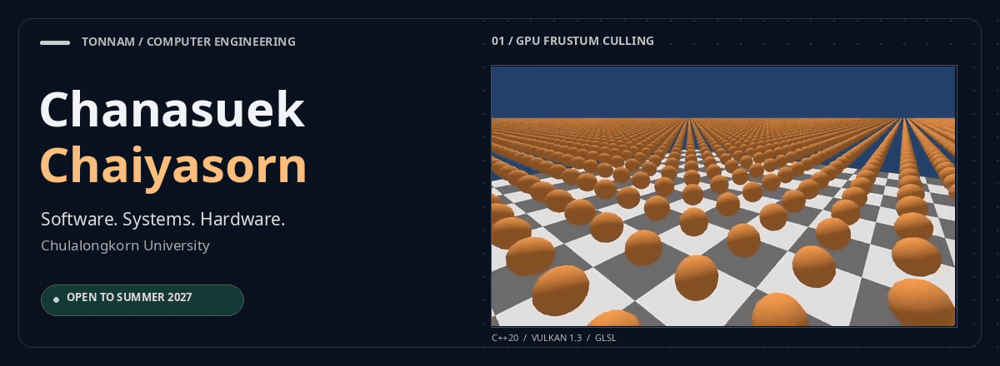
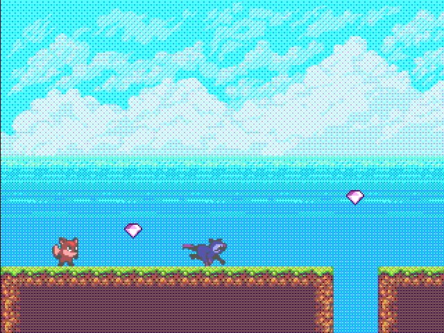

  <a href="#selected-work">Selected Work</a> &nbsp; / &nbsp;
  <a href="#small-builds">Small Builds</a> &nbsp; / &nbsp;
  <a href="#toolkit">Toolkit</a> &nbsp; / &nbsp;
  <a href="mailto:789852tonnam@gmail.com">Get in Touch</a>

**Hi, I'm Tonnam.** I'm a third-year Computer Engineering student at **Chulalongkorn University**, building across web applications, networked systems, GPU rendering and digital hardware. I'm especially interested in **infrastructure, cloud, security and hardware–software integration**.

**Summer 2027 internship → Available 20 May–31 July 2027**

## Selected Work

<table>
<tr>
<td width="50%" valign="top">
  01 &nbsp; / &nbsp; GRAPHICS &amp; PERFORMANCE
  <h3><a href="https://github.com/789852tonnam/GPU-Frustum-Culling-and-Indirect-Draw-in-Vulkan">GPU Frustum Culling ↗</a></h3>
  
GPU-driven rendering with indexed indirect drawing. Designed experiments comparing per-object and grouped culling, measuring performance and checking output against a CPU reference.

  
<code>C++20</code> <code>Vulkan</code> <code>GLSL</code> <code>RenderDoc</code>

  Individual project · AI-assisted development
</td>
<td width="50%" valign="top">
  02 &nbsp; / &nbsp; NETWORKS &amp; SYSTEMS
  <h3><a href="https://github.com/789852tonnam/Chat-System">Socket Chat ↗</a></h3>
  
TCP chat with persistent history and background AI summaries. Co-designed the protocol and room workflows, integrated an external AI API and helped prepare persistent Docker storage.

  
<code>Python</code> <code>TCP</code> <code>SQLite</code> <code>Docker</code>

  Team of 3 · Computer Networks
</td>
</tr>
<tr>
<td width="50%" valign="top">
  03 &nbsp; / &nbsp; WEB &amp; DATABASES
  <h3><a href="https://github.com/Sitta-C/HKTutor">HKTutor ↗</a></h3>
  
Tutor–student matching platform. Developed role-based dashboards and onboarding pages, built notification APIs and contributed API regression tests and database correctness checks.

  
<code>Next.js</code> <code>NestJS</code> <code>TypeScript</code> <code>PostgreSQL</code>

  Team of 10 · Software Engineering
</td>
<td width="50%" valign="top">
  04 &nbsp; / &nbsp; DIGITAL HARDWARE
  <h3><a href="https://github.com/789852tonnam/HWSynHomework-Camera-Module-with-Basys3">FPGA Camera &amp; Filters ↗</a></h3>
  
Camera integration and image processing on Basys 3. Implemented edge-detection, color-isolation and color-inversion filters; wrote testbenches and inspected waveforms and resource reports.

  
<code>Verilog</code> <code>Basys 3</code> <code>Vivado</code> <code>GTKWave</code>

  Team of 3 · Hardware Synthesis
</td>
</tr>
</table>

## Small Builds

<table>
<tr>
<td width="46%">
  
</td>
<td width="54%" valign="top">
  VERILOG / VGA PLAYGROUND
  <h3><a href="https://github.com/789852tonnam/Platformer_Game">A Small Platformer ↗</a></h3>
  
A small platformer written in Verilog, with a custom picture-processing unit, parallax scrolling, sprites, collisions, enemies and collectible gems.

  
<a href="https://vga-playground.com/?repo=https://github.com/789852tonnam/Platformer_Game"><b>▶ Open playable demo</b></a> &nbsp; · &nbsp; <a href="https://github.com/789852tonnam/Platformer_Game">Source code</a>

  Enable the gamepad; ← → move, ↑ / A / B jump. Artwork: <a href="https://ansimuz.itch.io/sunny-land-pixel-game-art">SunnyLand by Ansimuz</a>.
</td>
</tr>
</table>

## Toolkit

Technologies I've used in coursework, projects and personal experiments:

| Area | Technologies |
| :--- | :--- |
| **Languages & HDL** | Python · C · C++ · Java · JavaScript · TypeScript · SQL · Verilog |
| **Web & Data** | React · Next.js · NestJS · PostgreSQL · Prisma · SQLite |
| **Systems & Networking** | Fedora Linux · CLI · SSH · Tailscale · Docker · Wireshark |
| **Testing & Collaboration** | Git · GitHub · Jest · Supertest · Playwright · Python unittest/mock |
| **Graphics & Hardware** | Vulkan · GLSL · CMake · RenderDoc · Vivado · GTKWave |

## A Little More

- **Education:** Computer Engineering, Chulalongkorn University · 2024–2028 (expected) · **GPAX 3.82**.
- **Learning direction:** Linux systems, cloud infrastructure, security fundamentals and hardware–software integration.
- **How I work:** Team collaboration through Git and pull requests; AI-assisted development and testing with requirements, implementation review and hands-on evaluation.

---

**Let's connect → [789852tonnam@gmail.com](mailto:789852tonnam@gmail.com)**

The animated banner is captured from my Vulkan project. Team project descriptions reflect my contributions.
