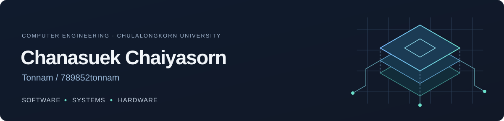

  

  <a href="#selected-projects">Projects</a> ·
  <a href="#technical-toolkit">Technical Toolkit</a> ·
  <a href="#education--internship">Education &amp; Internship</a> ·
  <a href="mailto:789852tonnam@gmail.com">Contact</a>

I'm **Tonnam**, a third-year Computer Engineering student at **Chulalongkorn University**. My projects span web applications, networked systems, GPU rendering and FPGA image processing. I'm interested in **infrastructure, cloud, security and hardware**, and enjoy understanding how software interacts with the systems underneath it.

**Seeking a Summer 2027 internship · Available 20 May–31 July 2027**

## Selected Projects

### [HKTutor](https://github.com/Sitta-C/HKTutor)
**Tutor–student matching platform · Team of 10** 
`TypeScript` `Next.js` `React` `NestJS` `PostgreSQL` `Prisma`

- Developed role-based dashboards, navigation and profile/onboarding pages, integrating team APIs.
- Built notification APIs with ownership checks, pagination and consistent read states; contributed API regression tests and database correctness checks.

### [Socket Chat](https://github.com/789852tonnam/Chat-System)
**TCP chat with AI conversation summaries · Team of 3** 
`Python` `TCP sockets` `SQLite` `Tkinter` `Docker`

- Co-designed the application protocol, private/group chat workflows and persistent message history with room-membership checks.
- Integrated background AI summaries through an external API and helped prepare a Docker server with persistent storage.

### [GPU Frustum Culling in Vulkan](https://github.com/789852tonnam/GPU-Frustum-Culling-and-Indirect-Draw-in-Vulkan)
**GPU-driven rendering and performance experiments · Individual project** 
`C++20` `Vulkan 1.3` `GLSL` `Python` `RenderDoc`

- Designed experiments comparing per-object and grouped GPU frustum culling with indexed indirect drawing.
- Measured culling, drawing and total GPU time separately, checking correctness against a CPU reference and RenderDoc captures.

### [Camera Module with Basys 3](https://github.com/789852tonnam/HWSynHomework-Camera-Module-with-Basys3)
**FPGA camera and image-processing project · Team of 3** 
`Verilog` `Basys 3` `Vivado` `GTKWave`

- Connected a camera module to a Basys 3 FPGA and implemented edge-detection, color-isolation and color-inversion filters.
- Wrote testbenches, inspected simulation waveforms and reviewed FPGA resource-utilization reports.

## Technical Toolkit

Tools and languages I've used in coursework, projects and personal experiments:

| Area | Technologies |
| :--- | :--- |
| Programming & HDL | Python, C, C++, Java, JavaScript, TypeScript, SQL, Verilog |
| Web & Databases | React, Next.js, NestJS, PostgreSQL, Prisma, SQLite |
| Systems & Networking | Fedora Linux, command line, SSH, Tailscale, Docker, Wireshark |
| Testing & Collaboration | Git, GitHub, Jest, Supertest, Playwright, Python unittest/mock |
| Graphics & Hardware | Vulkan, GLSL, CMake, RenderDoc, Vivado, GTKWave |

**Current interests:** Linux systems, cloud infrastructure, security fundamentals and hardware–software integration.

## How I Work

I work with teammates through Git branches, pull requests and code review. I use AI-assisted development and testing alongside requirements, implementation review, hands-on checks and evaluation. The projects above describe my contributions within each team's work.

## Education & Internship

**Chulalongkorn University · Computer Engineering** 
2024–2028 (expected) · Third-year student · **GPAX 3.82**

Relevant coursework: Operating Systems & System Programming, Database Systems, Data Structures, Algorithm Design, Computer Architecture and Digital Logic.

I'm looking for a **Summer 2027 technology internship**, with a particular interest in systems, infrastructure and hardware-related work. Available **20 May–31 July 2027**.

**Get in touch:** [789852tonnam@gmail.com](mailto:789852tonnam@gmail.com)
